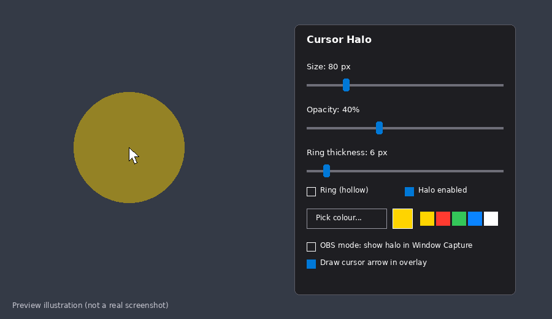

# Cursor Halo

A glowing halo that follows your mouse cursor on Windows 10/11. Set size, opacity, colour, and filled or ring style from a small settings window.

## Download
Release page: https://github.com/BenjisCollector/cursor-halo/releases/tag/latest

- **Windows 10/11:** [CursorHalo.exe](https://github.com/BenjisCollector/cursor-halo/releases/download/latest/CursorHalo.exe). Double-click. If SmartScreen warns, click **More info > Run anyway**.
- **Mac (Apple Silicon and Intel, macOS 11+):** [CursorHalo-mac.dmg](https://github.com/BenjisCollector/cursor-halo/releases/download/latest/CursorHalo-mac.dmg) (or the .zip). Drag **CursorHalo** to Applications. The app is unsigned: the first time, right-click it > **Open** > **Open**. If macOS says it is damaged, run `xattr -dr com.apple.quarantine /Applications/CursorHalo.app`.

Close the settings window to quit. Windows settings are in `%APPDATA%\CursorHalo\settings.json`.

## Source
- `CursorHalo.ps1`: Windows app (PowerShell + embedded C#), packaged with ps2exe.
- `macos/CursorHalo.swift`: Mac app (Swift/AppKit), built as a universal binary.
- `.github/workflows/build.yml`: builds both and publishes the release.

## Recording with OBS
- **Display Capture:** works with the normal halo.
- **Window Capture:** OBS only captures the chosen window, so a separate halo window is never included. Tick **OBS mode** in Cursor Halo. It draws the halo (and optionally a cursor arrow) in one transparent full-desktop window. In OBS: *Add source > Window Capture > "[CursorHalo.exe]: Cursor Halo Overlay (OBS)"*, set Capture Method to *Windows 10 (1903 and up)*, and put it above your video. It covers the whole desktop, so for a single-window recording line it up with that window and use a Crop filter.
- **Mac:** use Display Capture (Window Capture records only the chosen window, so the halo is not included).
